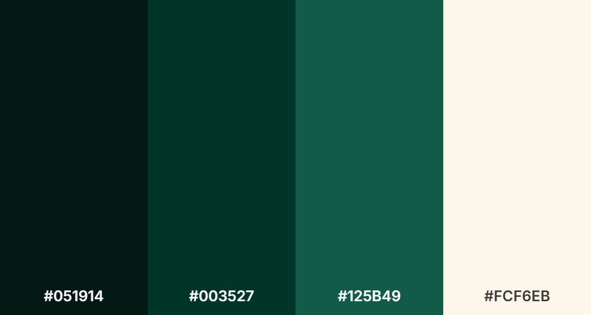

# GreenBox

 
## Cultiva, Recicla y Transforma

## Descripción

GreenBox es una plataforma digital que busca promover hábitos sostenibles brindando información sobre reciclaje y sobre cómo cultivar.

Su propósito es ayudar a las personas a reducir su impacto ambiental y aprender a cultivar sus propias plantas.

### Actividades principales

- Campañas de reciclaje y separación de residuos.
- Tutoriales sobre compostaje y reutilización.
- Consejos para ahorrar agua y energía.

### Problemas que busca solucionar

1. Muchas personas no saben cómo empezar a cultivar plantas en sus hogares.
2. Existe desconocimiento sobre la correcta separación de residuos.
3. Se desperdician materiales que podrían reutilizarse o reciclarse.
4. Las personas quieren adoptar hábitos sostenibles, pero no saben cómo hacerlo.

### Nuestra propuesta de valor

Ofrecer en un mismo lugar conocimientos que permitan a las personas transformar sus hogares en espacios más sostenibles mediante el reciclaje y el cultivo de plantas.

***

## Identidad visual

### Paleta de colores

- **Verde noche:** #051914
- **Verde pino:** #003527
- **Verde bosque:** #125B49
- **Marfil cálido:** #FCF6EB

### Tipografías

- **DM Sans** para títulos.
- **Inter** para textos.

### Tecnologías

- HTML5
- CSS3
- Bootstrap 5.3

***

## Requisitos funcionales

### 1. Descripción general

GreenBox será una landing page que busca promover hábitos sostenibles mediante información sobre reciclaje, cultivo de plantas y cuidado del medio ambiente.

### 2. Requisitos funcionales

| Código | Requisito funcional | Descripción |
| --- | --- | --- |
| RF-01 | Página de inicio | Mostrar el nombre, eslogan y presentación de GreenBox. |
| RF-02 | Menú de navegación | Permitir desplazarse entre las secciones de la landing page. |
| RF-03 | Sección de reciclaje | Mostrar información básica sobre separación y clasificación de residuos. |
| RF-04 | Sección de cultivo | Presentar consejos básicos para cultivar y cuidar plantas en casa. |
| RF-05 | Sección de compostaje | Mostrar información sobre cómo aprovechar los residuos orgánicos. |
| RF-06 | Consejos sostenibles | Presentar recomendaciones para ahorrar agua, energía y reutilizar materiales. |
| RF-07 | Pie de página | Mostrar información básica de GreenBox y sus medios de contacto. |

### 3. Estructura de la landing page

La página estará dividida en cinco secciones:

1. **Inicio:** logo, menú de navegación, eslogan e imagen principal.
2. **Reciclaje:** información sobre separación de residuos.
3. **Cultiva:** consejos para cultivar plantas en casa.
4. **Vida sostenible:** recomendaciones de compostaje, reutilización y ahorro de recursos.
5. **Pie de página:** información general y contacto.

### 4. Vistas de diseño

#### Vista desktop

#### Vista tablet

#### Vista mobile

### 5. Alcance del proyecto

- Desarrollo con HTML5, CSS3 y Bootstrap 5.3.
- Diseño visual sencillo, moderno y responsive.
- Navegación mediante enlaces internos.
- Contenido e imágenes estáticas.
- Sin formularios funcionales, bases de datos ni JavaScript.

**Objetivo:** desarrollar una landing page atractiva, informativa y funcional que presente la propuesta de GreenBox de manera clara, priorizando las funcionalidades esenciales para cumplir con el tiempo de desarrollo de dos días.
